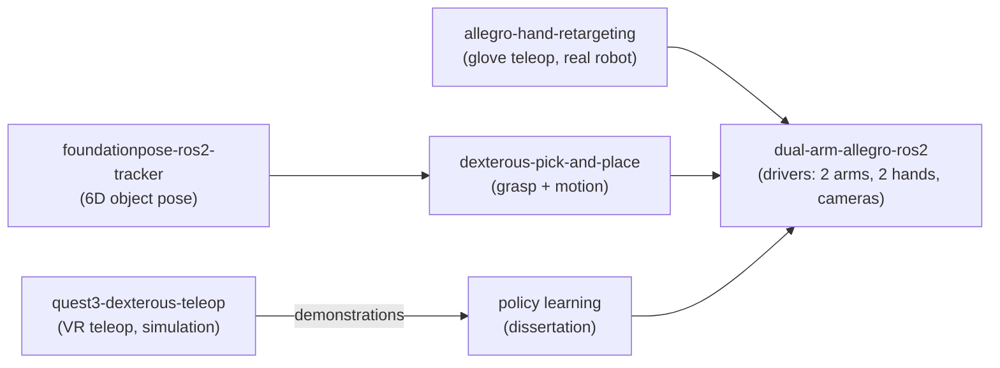

### Hi, I'm Ismael

**I make robot policies trained in simulation work on real robots.**

Robot learning researcher working on bimanual dexterous manipulation: two arms and two 16-DoF Allegro Hands
(44 joints), digital twins in Isaac Lab, transformer policies trained with imitation and reinforcement learning,
and ROS 2 deployment on the real robot. Ph.D. candidate at Kyung Hee University (degree expected Feb 2027),
open to research scientist and research engineer roles in robot learning.

[Website](https://ismael-esp.github.io) · [Google Scholar](https://scholar.google.com/citations?user=3S9BoVAAAAAJ)

---

#### Ph.D. research: Real2Sim2Real for bimanual dexterous manipulation

Build a digital twin from the real robot, record teleoperated demonstrations in the twin, pretrain a transformer
policy by behavior cloning, fine-tune it with PPO in parallel copies of the twin, then run it on the real robot
with no training on real-robot data. One robot, two configurations: table-mounted and upper-humanoid.

- **TC-TRL** (IEEE RA-L 2024, co-first author; Korean Patent 10-2943203). **Simulation:** 89.9% mean success
  on five long-horizon benchmark tasks, against 59.0% for the best transformer baseline.
- **Real robot, direct transfer:** four long-horizon tasks (three handovers and bimanual sweeping) succeeded in
  18 to 30 of 35 trials each; the same architecture trained by imitation alone reached at most 13 of 35.
- **Real robot, RGB only:** distilled into an RGB-only student (TMAD, under review), the policy reached 72 to 84%
  success on four tasks (mean of 3 runs × 25 trials).

The policy-training code of the dissertation is not public. The projects below are.

#### Open-source projects

| Project | What it is | Result |
|---|---|---|
| [dexterous-pick-and-place](https://github.com/ismael-esp/dexterous-pick-and-place) | FoundationPose 6D perception + BODex grasp synthesis for Allegro hands on the dual-arm UR3 / UR3e cell; one code path for Isaac Lab and the real robot | **Real robot (right arm):** 94/100 executed trials over 10 objects. **Isaac Lab (both arms):** 180/200 |
| [robotic-origami-challenge](https://github.com/ismael-esp/robotic-origami-challenge) | FoldingACT: vision + tactile action-chunking transformer (DINOv3, Sparsh) for bimanual paper folding with two 22-joint hands, IROS 2026 Robotic Origami Challenge; 398 GB LeRobot dataset, ten gated versions, Zenoh inference service | **Real robot (organizers'):** no fold completed; the failure is root-caused in the write-up. The fixed v10 is not tested on hardware |
| [foundationpose-ros2-tracker](https://github.com/ismael-esp/foundationpose-ros2-tracker) | Zero-shot 6D object tracking in ROS 2 from a mesh and an object name (YOLO-World, SAM 2, FoundationPose); CUDA patch for RTX 50xx (Blackwell) | **Real robot cell:** live tracking at about 3 to 5 Hz with the debug overlay; feeds the grasp planner |
| [quest3-dexterous-teleop](https://github.com/ismael-esp/quest3-dexterous-teleop) | Meta Quest 3 hand-tracking teleoperation and demonstration recorder for the dual-arm cell in Isaac Lab | **Simulation.** 81 unit tests; finger-flexion agreement r = 0.91 to 0.98 (default profile, recorded episodes) |
| [allegro-hand-retargeting](https://github.com/ismael-esp/allegro-hand-retargeting) | Two Manus gloves to two Allegro hands with learned retargeting (GeoRT fork) and a ROS 2 bridge | **Recorded glove sessions:** per-finger flexion agreement r = 0.87 to 0.97; 0.7 ms per hand |
| [dual-arm-allegro-ros2](https://github.com/ismael-esp/dual-arm-allegro-ros2) | ROS 2 Jazzy drivers for the whole cell: UR3 + UR3e arms, two Allegro Hand V4, three RealSense cameras, Docker | **Real robot:** 44 joints in one `/joint_states` at 100 Hz |

How the pieces fit:

#### Selected publications

- J.-H. Oh\*, **I. Espinoza Jaramillo\***, D. Jung, T.-S. Kim. Bimanual long-horizon manipulation via
  temporal-context transformer RL. IEEE Robotics and Automation Letters, 9(12), 2024, presented at IROS 2025.
  \*equal contribution. [doi](https://doi.org/10.1109/LRA.2024.3484167)
- **I. Espinoza**, Y.-H. Choi, K. Lee, J.-H. Oh, K. J. Pahk, T.-S. Kim. A Real2Sim2Real transformer policy
  system for bimanual R2R2H tasks. ACM/IEEE HRI 2026 Companion. [doi](https://doi.org/10.1145/3776734.3794489)
- Y.-H. Choi, **I. Espinoza**, et al. A semi-humanoid Real2Sim2Real system for bimanual long-horizon
  manipulation. International Conference on Ubiquitous Robots (UR), 2026, in press.
- J.-H. Oh, D. Jung, **I. Espinoza**, et al. Multi-modal affordance planner with temporal-context action policy
  for long-horizon bimanual robot manipulation. IEEE ICRA 2026. [doi](https://doi.org/10.1109/ICRA57385.2026.11695814)
- S. Park, **I. Espinoza**, et al. TMAD: Temporal multi-agent distillation for bimanual long-horizon
  manipulation. Under review, 2026.

Patents: Korean Patent 10-2943203 (granted 2026) and two Korean patent applications pending.
Full list on [Google Scholar](https://scholar.google.com/citations?user=3S9BoVAAAAAJ) and the [website](https://ismael-esp.github.io/#publications).

#### Tools

Python · C++ · PyTorch · CUDA · Isaac Lab / Isaac Sim · ROS 2 (Humble, Jazzy) · Docker · LeRobot · cuRobo ·
FoundationPose · UR3 / UR3e · Allegro Hand V4 · Intel RealSense
